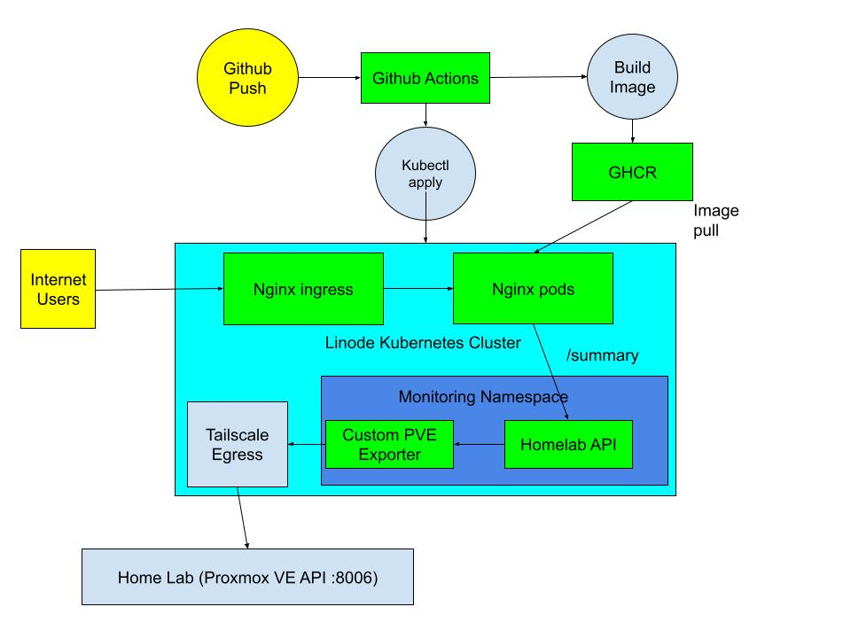

# seanslab.site — Sean's Lab

My personal portfolio site. It started as static pages on GitHub Pages, and I
rebuilt it into a containerized app running on a managed Kubernetes cluster with
an automated deploy pipeline and live metrics streamed from my home lab.

**Live:** https://seanslab.site

By rebuilding it into its current state, I learned more about deployment, containers, 
the CI/CD pipeline, and how modern web infrastructure is maintained. 

## Architecture



## Tech stack

| Layer          | Tools                                                    |
| -------------- | -------------------------------------------------------- |
| Frontend       | Static HTML/CSS/JS, Bootstrap, jQuery                    |
| Backend        | Python, FastAPI, pytest                                  |
| Web server     | nginx (port 8080)                                        |
| Container      | Docker on GitHub Container Registry (GHCR)               |
| Orchestration  | Kubernetes on Linode (LKE) — 2 replicas, rolling updates |
| TLS / Ingress  | nginx ingress controller + cert-manager                  |
| CI/CD          | GitHub Actions                                           |
| IaC            | Terraform — LKE cluster + Firewall                       |
| Monitoring     | Custom Proxmox VE exporter and API in cluster            |
| Networking     | Tailscale between cluster and home lab                   |

## Highlights

- **Zero-downtime deploys.** The Deployment uses `maxUnavailable: 0`, so a pod
  that doesn't pass its readiness probe stalls the rollout and fails the CI run
  while the old pods keep serving. A broken deploy won't make the site fail.
- **Live home-lab metrics.** The Home Lab page shows running VMs, CPU, memory,
  and storage from my Proxmox server. A custom Python exporter queries the Proxmox
  API over Tailscale with a read-only token, and a FastAPI service polls it every
  30 seconds and serves one cached JSON summary at /summary. Visitor traffic never
  reaches the home lab, and replacing the in-cluster kube-prometheus-stack took node
  CPU usage from 100% to about 20%.
- **Infrastructure as Code.** The LKE cluster is managed by Terraform, imported from the
  currently running cluster rather than rebuilt. A default-deny firewall is set up 
  on the nodes, allowing only internal cluster traffic while public access flows 
  through the NodeBalancer.

## Repository layout

```
├── index.html, 404.html, thank-you.html     Site pages
├── css/, js/, fonts/, images/, uploads/     Frontend 
├── files/                                   Resume
├── projects/                                Projects
│   ├── personal-website/
│   ├── home-lab-server/
│   ├── cisco-labs-practice/
│   └── pve-exporter-api/
├── Dockerfile                               nginx image build
├── nginx.conf                               Server config + /summary API proxy
├── terraform/                               Infrastructure as code
│   ├── provider.tf                          Provider + versions
│   ├── main.tf                              LKE cluster
│   ├── variables.tf
│   └── firewall.tf                          
├── k8s/                                     Deployment manifests
│   ├── 01-deployment.yaml
│   ├── 02-service.yaml
│   ├── 03-clusterissuer.yaml
│   ├── 04-ingress.yaml
│   ├── 05-egress-pve.yaml
│   ├── 06-pve-exporter.yaml
│   └── 07-homelab-api.yaml
└── .github/workflows/deploy.yml             CI/CD pipeline
```

## Deployment

Every push to main triggers `.github/workflows/deploy.yml`, which builds the
image, pushes it to GHCR, applies the manifests to LKE, and waits for the rollout 
to succeed before the run passes. The custom exporter and API images are built in
their own repo pipelines and are rolled out manually. 

## Projects featured on the site

- **Personal Website** — This repo: static-to-Kubernetes migration.
- **Home Lab Server** — Proxmox virtualization, Windows Server AD/DHCP,
  Prometheus/Grafana monitoring, Ansible automation.
- **Cisco Modeling Labs** — Network automation practice beyond Packet Tracer.
- **Custom PVE-Exporter + API** — Custom exporter and API for fetching metrics 
  from my server
